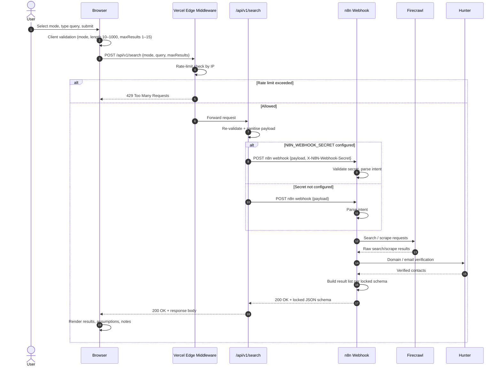
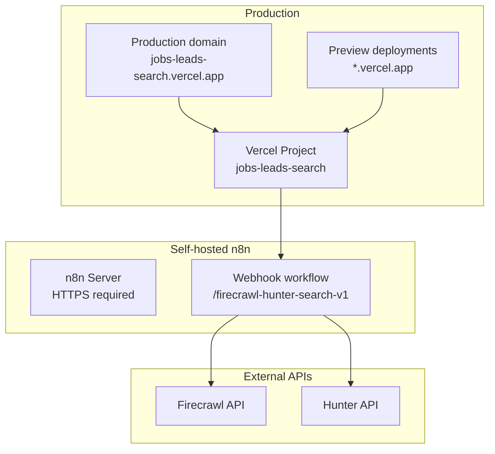

# Architecture Document — Jobs & Sales Leads Search UI + n8n Workflow

## Document control

| Field | Value |
|-------|-------|
| Status | Draft for Gate G2 approval |
| Author | Solution Architect subagent |
| Date | 2026-10-20 |
| Next gate | G3 (Build / parallel development) |

---

## 1. Overview

This document describes the system architecture for the Jobs & Sales Leads Search demo. The design keeps the stack intentionally thin: a Next.js / React frontend hosted on Vercel, a small serverless API route for transport security, and the existing self-hosted n8n workflow that orchestrates Firecrawl and Hunter.

The architecture prioritises speed-to-validation for a portfolio demo while remaining production-presentable in the areas that matter for a public, auth-free app: HTTPS everywhere, input validation, rate limiting, and a locked API contract.

---

## 2. High-level system diagram

```mermaid
flowchart LR
    subgraph User
        B[Browser]
    end

    subgraph Vercel
        NX[Next.js App]
        AR[/api/v1/search\nRoute Handler]
        EM[Vercel Edge Middleware\nrate limiting / CORS]
    end

    subgraph SelfHosted["Self-hosted n8n"]
        WH[n8n Webhook\nWorkflow]
        FC[Firecrawl node]
        HU[Hunter node]
    end

    B -->|HTTPS POST /api/v1/search| EM
    EM --> NX
    NX --> AR
    AR -->|HTTPS POST webhook| WH
    WH --> FC
    WH --> HU
    WH --> AR
    AR --> B
```

**Key points from the diagram**

- The browser never talks directly to n8n, Firecrawl, or Hunter.
- The only public backend surface the frontend knows is `/api/v1/search` on the Vercel deployment.
- The Next.js Route Handler is a *thin, stateless pass-through*: it validates input, enforces rate limits, optionally attaches a shared secret, forwards the request to the n8n webhook, and returns the response.
- The n8n workflow remains the owner of business logic, intent parsing, and external API calls.

---

## 3. Component responsibilities

### 3.1 Next.js frontend (Browser)

- Render the mode selector (`jobs` / `clients` / `both`), natural-language input, and result cards.
- Validate input client-side before submission (mode, query length 10–1000, optional `maxResults` 1–15).
- Manage UI states: idle, submitting, loading, partial results, complete results, empty, error.
- Call only the Vercel-hosted `/api/v1/search` endpoint.
- Render results according to the locked n8n output schema.
- Provide source links, contact links (`mailto:`, LinkedIn), and sorting by priority / recency.
- Implement client-side debounce and session-level abuse hints.

### 3.2 Vercel Edge Middleware

- Run before every `/api/v1/search` request.
- Enforce IP-based rate limits (10 req/min and 50 req/day per IP).
- Add CORS preflight handling for the browser origin.
- Optionally block requests with missing or malformed headers.
- Stateless; does not persist query history or PII.

### 3.3 Next.js Route Handler — `/api/v1/search`

- Accept `POST` requests from the browser.
- Re-validate and sanitise the payload.
- Read the n8n webhook URL and optional secret from environment variables.
- If `N8N_WEBHOOK_SECRET` is set, attach the `X-N8N-Webhook-Secret` header before forwarding.
- If `N8N_WEBHOOK_SECRET` is not set, skip the header and log a runtime warning that the integration is operating without webhook authentication.
- Forward the request to the self-hosted n8n webhook over HTTPS.
- Return the n8n response body as-is on success.
- Map n8n / network errors into the agreed error envelope documented in `API-CONTRACT.md`.
- Add observability headers where useful (`X-Request-Id`, response timing).

**Design note:** This is *not* a custom backend service. It is a single serverless function co-located with the frontend, used only to hide the n8n webhook URL and secret from the browser and to centralise rate-limiting.

### 3.4 Self-hosted n8n workflow

- Expose a Webhook node at a hard-to-guess path.
- If configured, validate the shared secret in the request header.
- Parse the natural-language query and infer intent, location, role, industry, etc.
- Call Firecrawl for web search and scrape.
- Call Hunter for domain and email verification.
- Build the result list matching the locked output schema.
- Return `mode`, `intent_summary`, `assumptions`, `leads[]`, and `notes`.
- Enforce the 15-result maximum in the workflow logic.
- Surface partial failures inside `notes` rather than failing the whole execution when possible.

### 3.5 Firecrawl

- Web search and scrape for public job listings or company signals.
- Called by n8n; never called by the frontend.

### 3.6 Hunter

- Domain and email verification.
- Called by n8n; never called by the frontend.

---

## 4. Data flow — search request end-to-end



**Latency expectations**

- Client → Vercel: < 200 ms in most regions.
- Vercel → n8n: Depends on the self-hosted n8n region; target < 500 ms.
- n8n → Firecrawl + Hunter: 3–12 s for a typical query.
- Total p95 target: < 15 s for up to 15 results.

---

## 5. Deployment topology



- **Frontend:** Vercel, auto-deployed from the main branch; preview deployments on pull requests.
- **Backend:** Existing self-hosted n8n instance maintained by the stakeholder.
- **External APIs:** Firecrawl and Hunter, accessed only by n8n.
- **HTTPS:** Required for Vercel, n8n, Firecrawl, and Hunter.

---

## 6. Environment variables and secrets strategy

### 6.1 Vercel environment variables

| Variable | Required | Purpose | Example |
|----------|----------|---------|---------|
| `N8N_WEBHOOK_URL` | Yes | Full URL of the n8n webhook node | `https://deskbound-octopus-modulator.ngrok-free.dev/webhook/stryde` |
| `N8N_WEBHOOK_USERNAME` | Yes | Basic auth username for the n8n webhook | `stryde_user` |
| `N8N_WEBHOOK_PASSWORD` | Yes | Basic auth password for the n8n webhook | `stryde_pass` |
| `RATE_LIMIT_PER_MINUTE` | No | Max requests per IP per minute | `10` |
| `RATE_LIMIT_PER_DAY` | No | Max requests per IP per day | `50` |
| `NEXT_PUBLIC_APP_URL` | No | Canonical app URL for shareable links / SEO | `https://jobs-leads-search.vercel.app` |

**Notes**

- `N8N_WEBHOOK_USERNAME` and `N8N_WEBHOOK_PASSWORD` are used for HTTP Basic Authentication to the n8n webhook. The Route Handler encodes them as `Authorization: Basic <base64(username:password)>`.
- These credentials are stored as encrypted Vercel environment variables and are never sent to the browser.
- Rotate the password in n8n and Vercel together if the credentials are leaked.

**Secrets management**

- `N8N_WEBHOOK_URL`, `N8N_WEBHOOK_USERNAME`, and `N8N_WEBHOOK_PASSWORD` are stored as encrypted Vercel environment variables.
- They are never sent to the browser.
- Rotate credentials if a preview deployment URL is leaked.

### 6.2 n8n environment variables

| Variable | Required | Purpose |
|----------|----------|---------|
| `FIRECRAWL_API_KEY` | Yes | Firecrawl API credential |
| `HUNTER_API_KEY` | Yes | Hunter API credential |

**Basic auth in n8n**

- In the n8n Webhook node, set **Authentication** to **Basic Auth** and define the username/password.
- The same username/password must be provided to Vercel as `N8N_WEBHOOK_USERNAME` and `N8N_WEBHOOK_PASSWORD`.
- Restrict n8n webhook access by basic auth and, if possible, by source IP range. If the ngrok URL is public, basic auth is essential.

### 6.3 n8n webhook basic auth setup guide

The stakeholder uses HTTP Basic Authentication in the n8n Webhook node. Follow these steps to configure or verify it.

1. Open the workflow that receives the search request.
2. Select the **Webhook** node.
3. In **Authentication**, choose **Basic Auth**.
4. Set **Username** and **Password** to the credentials you want to use.
5. Save the workflow and copy the webhook URL.
6. In Vercel, add three environment variables:
    - `N8N_WEBHOOK_URL` = the copied webhook URL.
    - `N8N_WEBHOOK_USERNAME` = the username from step 4.
    - `N8N_WEBHOOK_PASSWORD` = the password from step 4.
7. Redeploy the Vercel project so the new variables are available to the Route Handler.

**Verification:** From a terminal, run:
```bash
curl -u username:password \
  -H "Content-Type: application/json" \
  -d '{"mode":"jobs","query":"Remote AI automation roles","maxResults":15}' \
  https://deskbound-octopus-modulator.ngrok-free.dev/webhook/stryde
```
You should receive a JSON response matching the locked output schema.

---

## 7. Error-handling and retry strategy

### 7.1 Client-side (browser)

- Validate mode, query length (10–1000), and `maxResults` (1–15) before submission.
- Disable submit button while a request is in flight.
- Set a client timeout of **20 seconds**.
- On network error or 5xx: allow **one retry** with exponential backoff (1 s, then 2 s).
- On 429: show a friendly "too many requests" message with a cooldown hint.
- On timeout: show a retry button and a reassuring message.
- Never display raw stack traces, n8n execution IDs, or internal URLs.

### 7.2 Server-side (Next.js Route Handler)

- Return `400` for invalid payloads.
- Return `429` when the rate limit is hit.
- Return `502` when n8n returns a non-2xx status.
- Return `504` when n8n / Firecrawl / Hunter times out.
- Return `500` only for unexpected handler failures.
- Always return errors in the agreed JSON envelope (see `API-CONTRACT.md`).

### 7.3 Backend-side (n8n)

- Catch Firecrawl / Hunter failures per source.
- When a source fails but others return data, continue the workflow and describe the partial failure in `notes`.
- Only fail the entire execution when no sources can be reached or the query cannot be parsed.
- Include `intent_summary` and `assumptions` even on partial or empty results so the frontend can render helpful context.

### 7.4 Retry matrix

| Failure | Layer | Retry? | User-facing action |
|---------|-------|--------|-------------------|
| Invalid input | Client | No | Show validation message |
| Rate limited (429) | Middleware | No | Show cooldown message |
| Network error | Client | Yes, 1x | Auto-retry, then retry button |
| n8n 5xx | Client | Yes, 1x | Auto-retry, then retry button |
| n8n timeout (504) | Client | Yes, 1x | Auto-retry, then retry button |
| Partial source failure | n8n | Per-node n8n policy | Show warning + available results |
| Complete source failure | n8n | No | Show error + retry button |

---

## 8. Real-time / streaming assessment

### 8.1 Current stack capabilities

- n8n Webhook nodes are fundamentally **synchronous**: they wait for the workflow to reach a *Respond to Webhook* node and then return the full payload.
- Firecrawl and Hunter calls happen sequentially or in parallel inside the workflow; the frontend receives nothing until all calls finish and the workflow responds.
- Streaming partial results would require either:
  - A long-running workflow that pushes incremental updates over WebSocket, Server-Sent Events (SSE), or a callback URL.
  - A major redesign of the existing n8n workflow to emit chunks.

### 8.2 Feasibility for the demo

- **Technically possible** but not trivial with the existing webhook-based workflow.
- Adds significant complexity: connection state management, fallback for disconnected clients, and likely changes to the n8n workflow.
- Does not reduce the total time spent waiting for Firecrawl / Hunter; it only improves *perceived* speed.

### 8.3 Recommendation

**Stay batch / async for the MVP.** Implement a polished loading experience instead:

- Skeleton cards while waiting.
- Reassuring status text ("Searching…", "Still searching, this can take a moment" after 10 s).
- Progress indeterminate bar.
- Soft timeout message at 15 s with a cancel/retry option.

Record streaming as a **post-MVP experiment** only if user feedback shows the wait time hurts activation (M2). If attempted later, prefer **Server-Sent Events (SSE)** over WebSockets because the data flow is server → client and unidirectional.

---

## 9. Security considerations for a public, auth-free demo

### 9.1 Transport

- All traffic uses HTTPS/TLS: Vercel (default), n8n (must be configured), Firecrawl, Hunter.
- The n8n instance must serve a valid TLS certificate; self-signed certificates are not acceptable for browser clients.

### 9.2 Input validation and sanitisation

- Enforce mode enum, query length 10–1000, and `maxResults` 1–15 on both client and server.
- Strip or escape HTML/script tags before rendering any user-entered text.
- Render result fields as plain text; do not use `dangerouslySetInnerHTML` for user-facing content.

### 9.3 CORS

- The Next.js Route Handler sets `Access-Control-Allow-Origin` to the canonical production domain.
- Preview deployments can be allowed by adding `*.vercel.app` or a specific preview domain list, but this widens the attack surface.
- The n8n webhook should reject requests without the shared secret if one is configured.

### 9.4 Rate limiting and abuse protection

- **Primary:** IP-based rate limiting in Vercel Edge Middleware (10 req/min, 50 req/day).
- **Secondary:** Client-side debounce and session-level caps.
- **Backend:** n8n workflow validates the shared secret if configured; consider adding a per-day global cap inside n8n if the tool tier is limited.
- No authentication is required, but the combination of IP limits + optional webhook secret provides basic protection against trivial abuse.

### 9.5 Secrets management

- n8n webhook URL and secret are server-side only.
- Firecrawl and Hunter API keys live only in n8n.
- Rotate secrets immediately if leaked.

### 9.6 Privacy

- Do not persist queries, results, or contact data on Vercel.
- Local browser history (if implemented as a "Could have") uses `localStorage` only and is cleared with browser data.
- Do not log PII to Vercel analytics or server logs.

### 9.7 Data-source compliance

- Rely on Firecrawl and Hunter public/free tiers only.
- Display source attribution via `source_url`.
- Do not scrape behind logins or bypass robots/TOS.
- Add a footer or about page noting that results are public data with attribution.

---

## 10. Risks and open questions

| ID | Risk / question | Impact | Status | Mitigation / next step |
|----|-----------------|--------|--------|------------------------|
| RQ-1 | **n8n workflow latency exceeds 15 s.** | Medium | Open | Monitor p95; optimise n8n node concurrency; keep batch UX; add timeout handling. |
| RQ-2 | **Self-hosted n8n downtime or version drift.** | High | Open | Stakeholder maintains instance; document ops runbook; consider health-check endpoint. |
| RQ-3 | **Firecrawl / Hunter rate limits or API changes.** | High | Open | n8n handles graceful degradation; monitor usage; keep fallback messaging. |
| RQ-4 | **Public app abused despite IP limits.** | Medium | Open | Start with IP limits + optional secret; add global daily cap in n8n if needed; defer auth until traction. |
| RQ-5 | **Exact n8n mode values.** | Low | **Answered** | Modes confirmed as `jobs` / `clients` / `both`. Result `type` strings assumed to be `job` / `client` / `both`; confirm with workflow if possible. |
| RQ-6 | **Contact population by mode.** | Low | **Answered** | `contacts[]` may be populated for any item where Hunter finds a verified email; no mode-specific restriction assumed. |
| RQ-7 | **Result limits enforced where?** | Low | **Answered** | Max 15 results, enforced in Next.js handler and in n8n. Default `maxResults` is 15. |
| RQ-8 | **Exposing n8n webhook to Vercel only.** | Low | **Answered** | Use shared secret (recommended but optional for demo); restrict n8n webhook source IP to Vercel egress ranges if possible. |

---

## 11. Gate G2 approval checklist

Before moving to Gate G3, confirm:

- [ ] The thin Next.js API route approach is accepted over direct browser-to-n8n calls.
- [ ] The `/api/v1/search` endpoint and locked n8n output schema are approved.
- [ ] Mode enum values (`jobs` / `clients` / `both`) are approved.
- [ ] Rate-limit values (10/min, 50/day) and `maxResults` bounds (1–15, default 15) are approved.
- [ ] Query length bounds (10–1000 characters) are approved.
- [ ] The self-hosted n8n instance will expose a single webhook path and optionally validate a shared secret.
- [ ] Batch UX is approved; streaming is deferred post-MVP.
- [ ] Stakeholder confirms n8n result `type` strings for each mode (`job` / `client` / `both` assumed).
- [ ] Stakeholder confirms Firecrawl + Hunter free-tier limits are sufficient for expected demo traffic.

---

## 12. Change log

| Version | Date | Author | Change |
|---------|------|--------|--------|
| 0.1 | 2026-10-20 | Solution Architect | Initial architecture for Gate G2. |
| 0.2 | 2026-10-20 | Solution Architect | Updated for three modes, 1000-char query, 15-result limit, optional webhook secret, and added n8n secret setup guide. |
